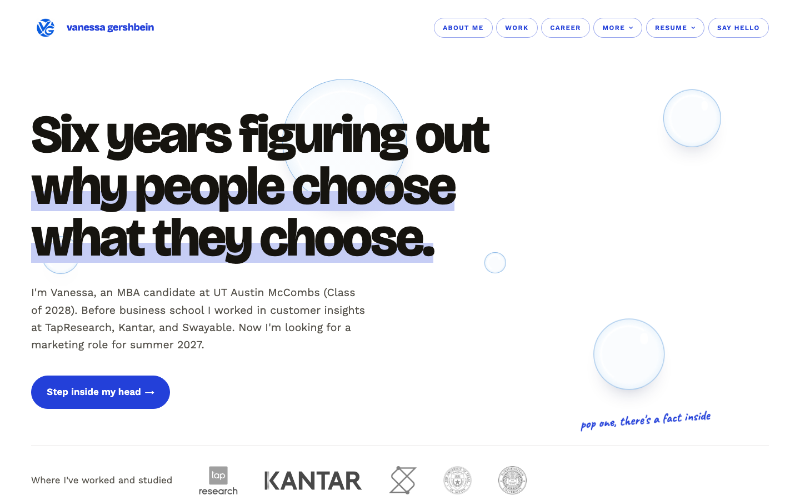
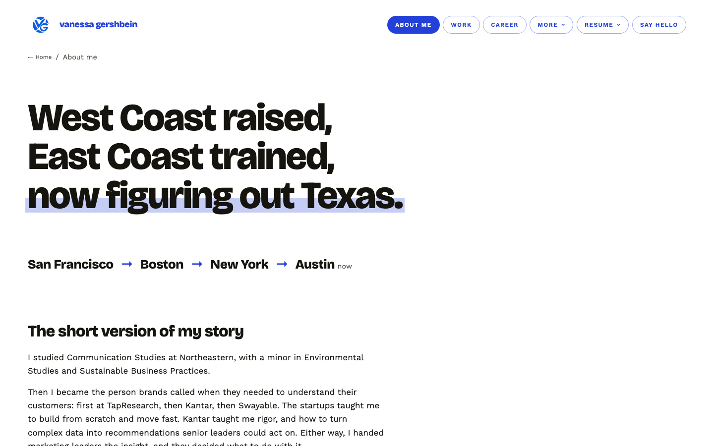
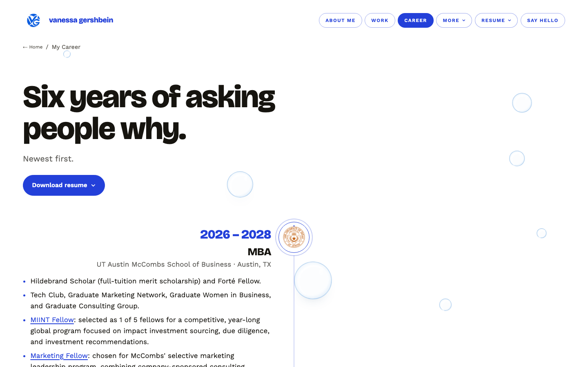
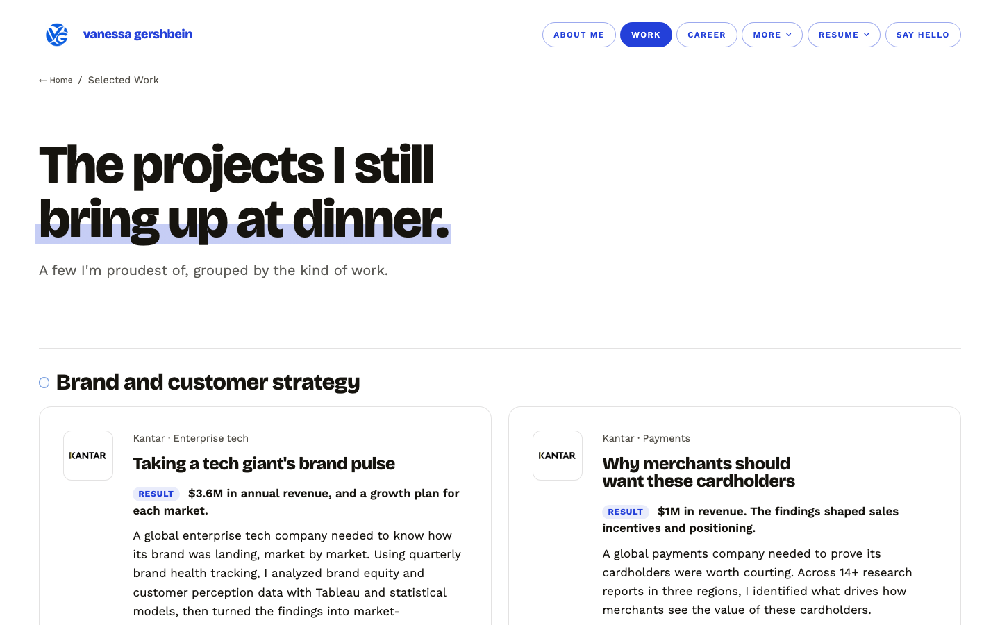

# Vanessa Gershbein · personal site

**Live at [vanessagershbein.netlify.app](https://vanessagershbein.netlify.app)**

I spent six years figuring out why people choose what they choose. Now I'm an MBA candidate at UT Austin McCombs (Class of 2028), and this is the site I built to show it: part portfolio, part invitation to grab a coffee.



## What's inside

- **A home page you can play with.** Soap bubbles drift behind the headline. Pop one and it reveals a real fact about me.
- **What I believe about marketing.** The About page opens with my story, then the takeaways I keep coming back to, each linking to the post or project it came from.
- **Results first.** Selected Work groups real projects by the kind of work, leads each one with its result, and turns a few into quick guessing games.
- **A career timeline** that fills in as you scroll.
- **A contact form** that sends straight to my inbox.

| About me | Career timeline | Selected Work |
| --- | --- | --- |
|  |  |  |

## How it's built

I designed and built this site with Claude, starting from two sites I admired. I wrote the copy, chose the look, and shipped it.

- **No framework.** Plain HTML, CSS, and a little JavaScript.
- **One script builds every page.** `build.py` holds all the copy and writes each page into `site/`. To change a page, edit the copy there and run `python3 build.py`.
- **Hosted on Netlify**, which publishes the `site/` folder and handles the contact form.

```
build.py        every page's copy and layout
site/           the finished website
  styles.css    all the styling
  landing.js    home page bubbles and the facts inside them
  bubble.js     floating bubbles and small pops around the site
  quiz.js       the guessing games on Selected Work
screenshots/    images for this page
```

## Say hello

[LinkedIn](https://www.linkedin.com/in/vanessa-gershbein/) · or use the form at the bottom of any page.

---

The words, photos, and design on this site are my own. Please don't reuse them without asking.
